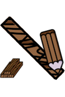
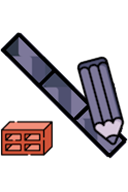
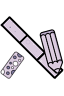
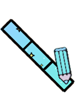
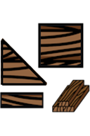
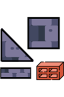
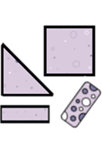

# Building Materials

[Wiki Home](../README.md) · [All Element Categories](../README.md#explore-the-wiki)

Building Materials are used to construct ships, vehicles, structures, and machines. Each material is available as a drawn **Line** and as an individual solid element. Newly placed pieces briefly stick to nearby elements, making assemblies easier to build while the simulation is paused.

## Line Materials

| Icon | Element | Description |
| :---: | --- | --- |
|  |  **Wood (Line)** | Draws a connected wooden part for lightweight constructions. Wood can burn. |
|  |  **Stone (Line)** | Draws a connected stone part for solid structures. |
|  |  **Steel (Line)** | Draws a connected steel part for heavy and strong constructions. |
|  |  **Styrofoam (Line)** | Draws a connected lightweight styrofoam part. |
|  |  **Glass (Line)** | Draws a connected glass part for transparent or fragile structures. |

## Individual Materials

| Icon | Element | Description |
| :---: | --- | --- |
|  |  **Wood** | Places an individual wooden building piece. It is relatively light and combustible. |
|  |  **Stone** | Places an individual stone building piece. |
|  |  **Steel** | Places an individual steel building piece suited to heavy constructions. |
|  |  **Styrofoam** | Places an individual lightweight styrofoam building piece. |
|  |  **Glass** | Places an individual glass building piece. |

## Tips

- Pause the simulation before placing or connecting building materials.
- Choose materials according to weight, strength, buoyancy, and heat exposure.
- Test a construction before adding cargo, motors, or [explosives](explosives.md).

## Related Guides

[Building Tutorials](../guides/building-tutorials.md) · [Controls and Tools](../guides/controls-and-tools.md)

## Related Gameplay Systems

[Building and Connections](../systems/building-and-connections.md) · [Physics and Forces](../systems/physics-and-forces.md) · [Destruction, Explosions and Weapons](../systems/destruction-explosions-and-weapons.md)

## Other Element Pages

| Category | Category |
| --- | --- |
| [Chemical Materials](chemical-materials.md) | [Explosives](explosives.md) |
| [Functional Elements](functional-elements.md) | [Gases](gases.md) |
| [Joints and Connectors](joints-and-connectors.md) | [Liquids](liquids.md) |
| [Objects and Decoration](objects-and-decoration.md) | [Powers](powers.md) |
| [Ragdolls, Body Parts and Ragdoll Chemicals](ragdolls-body-parts-and-chemicals.md) | [Terrain](terrain.md) |
| [Weapons, Missiles and Airstrikes](weapons-missiles-and-airstrikes.md) | |
