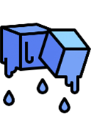
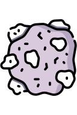

# Chemical Materials

[Wiki Home](../README.md) · [All Element Categories](../README.md#explore-the-wiki)

Chemical Materials are solid particle-based substances with distinct temperature and combustion behavior. They can be drawn directly into the sandbox and combined with [fire](powers.md#fire), liquids, and cooling effects.

## Materials

| Icon | Element | Description |
| :---: | --- | --- |
|  |  **Ice** | A frozen material that melts when exposed to heat such as [fire](powers.md#fire). |
|  |  **Coal** | A combustible solid that starts burning when ignited. |
|  |  **Lead** | Melts when heated and solidifies again as it cools. |
|  |  **Magnesium** | Burns with a very bright flame after it is ignited. |
|  |  **Thermite** | Burns at an extremely high temperature and can spread [fire](powers.md#fire) to nearby materials. |

## Tips

- Pause the simulation when arranging a controlled material test.
- Place heat and cooling sources at different distances to compare reactions.
- Use a non-flammable container when testing Magnesium or Thermite.

## Related Guides

[FAQ and Troubleshooting](../guides/faq-and-troubleshooting.md)

## Related Gameplay Systems

[Temperature](../systems/temperature.md) · [Destruction, Explosions and Weapons](../systems/destruction-explosions-and-weapons.md)

## Other Element Pages

| Category | Category |
| --- | --- |
| [Building Materials](building-materials.md) | [Explosives](explosives.md) |
| [Functional Elements](functional-elements.md) | [Gases](gases.md) |
| [Joints and Connectors](joints-and-connectors.md) | [Liquids](liquids.md) |
| [Objects and Decoration](objects-and-decoration.md) | [Powers](powers.md) |
| [Ragdolls, Body Parts and Ragdoll Chemicals](ragdolls-body-parts-and-chemicals.md) | [Terrain](terrain.md) |
| [Weapons, Missiles and Airstrikes](weapons-missiles-and-airstrikes.md) | |
