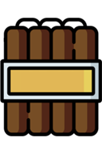
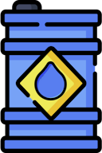
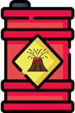
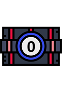
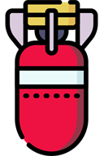
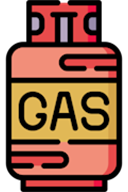
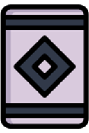

# Explosives

[Wiki Home](../README.md) · [All Element Categories](../README.md#explore-the-wiki)

Explosives create blasts, release materials, apply special effects, or produce fireworks. Many explosives can be configured to detonate on collision or after a timer. The **Fuse** can be used to connect several explosives and create chain reactions.

## Bombs and Grenades

| Icon | Element | Description |
| :---: | --- | --- |
|  |  **Grenade** | A general-purpose explosive that creates a standard blast. |
|  |  **Cluster Bomb** | Creates multiple smaller explosions across the surrounding area. |
|  |  **Multi Bomb** | Produces a sequence of multiple small explosions. |
|  |  **Cycle Bomb** | Repeatedly creates small explosions in a cycle. |
|  |  **TNT** | Creates a small, weak explosion that normally cannot start a chain reaction by itself. |
|  |  **Bouncy Bomb** | A highly bouncy bomb that detonates when it hits something. |
|  |  **Frag Grenade** | Releases shrapnel that can injure nearby [ragdolls](ragdolls-body-parts-and-chemicals.md). |
|  |  **Nuclear Bomb** | Produces a massive explosion with a very large destructive effect. |

## Material and Effect Bombs

| Icon | Element | Description |
| :---: | --- | --- |
|  |  **Water Bomb** | Releases [water](powers.md#water) when it explodes. |
|  |  **Lava Bomb** | Releases hot [lava](powers.md#lava) when it explodes. |
|  |  **Colored Liquid Bomb** | Releases liquid in a color selected in the element settings. |
|  |  **Oil Bomb** | Releases [oil](powers.md#oil) when it explodes. The [oil](powers.md#oil) can be ignited afterward. |
|  |  **Virus Bomb** | Spreads [virus](powers.md#virus) material around the point of detonation. |
|  |  **Ice Bomb** | Freezes nearby elements when it explodes. |
|  |  **Zero Gravity Bomb** | Temporarily sets gravity to zero after detonation. |
|  |  **Implosion** | Pulls nearby elements inward with a powerful implosive force. |
|  |  **Black Hole Bomb** | Creates a black hole that pulls nearby elements in before eventually exploding. |
|  |  **Vaporizer** | Produces intense heat and vaporizes nearby liquids. |
|  |  **Smoke Grenade** | Releases smoke instead of producing a conventional destructive blast. |

## Gas Tanks

| Icon | Element | Description |
| :---: | --- | --- |
|  |  **Gas Tank** | Leaks gas when triggered, propelling the tank forward until it explodes. |
|  |  **Explosive Gas Tank** | Releases flammable gas that rises and can explode when ignited. |

## Ignition

| Icon | Element | Description |
| :---: | --- | --- |
|  |  **Fuse** | A burnable connection used to ignite and link different explosives in a chain reaction. |

## Fireworks and Effects

| Icon | Element | Description |
| :---: | --- | --- |
|  |  **Firecracker** | Creates a small explosion with colorful visual effects. |
|  |  **Firework Rocket** | Flies like a rocket and creates a firework effect at the end of its path. |
|  |  **Bengal Fire** | Burns with an extremely hot and bright flame. |
|  |  **Confetti** | Sprays colorful confetti into the air. |
|  |  **Sparkler** | Continuously produces bright sparkling effects. |
|  |  **Fireworks Battery** | Launches several projectiles to create multiple firework effects. |
|  |  **Firework: "Piper"** | Moves in random directions while producing its firework effect. |
|  |  **Firework: "Flicker"** | Creates a flickering firework effect. |

## Tips

- Use a **Fuse** to delay ignition or connect several explosives.
- Material bombs can be combined with [fire](powers.md#fire), temperature, liquids, and terrain to create larger reactions.
- Test powerful explosives in an open area before placing them inside a detailed creation.
- Pause the simulation while arranging a complex chain reaction.

## Related Guides

[FAQ and Troubleshooting](../guides/faq-and-troubleshooting.md) · [Saving and Loading](../guides/saving-and-loading.md)

## Related Gameplay Systems

[Destruction, Explosions and Weapons](../systems/destruction-explosions-and-weapons.md) · [Temperature](../systems/temperature.md)

## Other Element Pages

| Category | Category |
| --- | --- |
| [Building Materials](building-materials.md) | [Chemical Materials](chemical-materials.md) |
| [Functional Elements](functional-elements.md) | [Gases](gases.md) |
| [Joints and Connectors](joints-and-connectors.md) | [Liquids](liquids.md) |
| [Objects and Decoration](objects-and-decoration.md) | [Powers](powers.md) |
| [Ragdolls, Body Parts and Ragdoll Chemicals](ragdolls-body-parts-and-chemicals.md) | [Terrain](terrain.md) |
| [Weapons, Missiles and Airstrikes](weapons-missiles-and-airstrikes.md) | |
