# Functional Elements

[Wiki Home](../README.md) · [All Element Categories](../README.md#explore-the-wiki)

Functional Elements apply forces, move materials, control temperature, measure movement, or automate a construction. Many of them have additional settings for strength, range, direction, timing, or selected material.

## Force and Movement

| Icon | Element | Description |
| :---: | --- | --- |
| 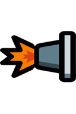 |  **Thruster** | Applies a strong forward force for rockets, boats, and other vehicles. |
|  |  **Booster** | Pushes elements forward when they enter its active area. |
| 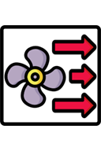 |  **Fan** | Blows nearby elements and liquids away in one direction. |
| 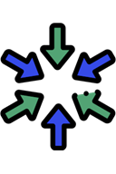 |  **Attractor** | Pulls nearby elements and liquids toward itself. |
| 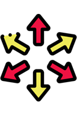 |  **Pusher** | Pushes nearby elements and liquids away from itself. |
| 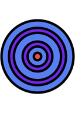 |  **Expander** | Alternates between expanding and shrinking; useful for wave generators and moving mechanisms. |
|  |  **Balloon** | Generates upward movement and can lift attached elements. |
| 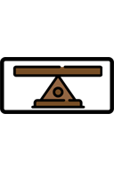 |  **Stabilizer** | Keeps a construction horizontal and helps prevent it from flipping over. |
|  |  **Moving Wall 1** | Moves from its start point to an end point, jumps back, and repeats. |
| 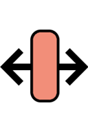 |  **Moving Wall 2** | Continuously moves back and forth between two points. |

## Processing and Automation

| Icon | Element | Description |
| :---: | --- | --- |
|  |  **Destroyer** | Removes every element that touches it. |
|  |  **Black Hole** | Pulls nearby elements inward and destroys them. |
| 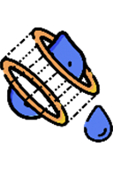 |  **Liquid Teleporter** | Moves liquids from an input point to an output point. |
|  |  **Element Spawner** | Periodically creates the element selected in its settings. |
|  |  **Glue** | Causes elements that touch it to stick. |
| 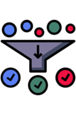 |  **Liquid Color Filter** | Allows only liquid particles matching a selected color to pass. |
| 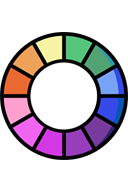 |  **Liquid Color Changer** | Changes touching liquids to the selected color. |
|  |  **Water Magic Tablet** | Changes the color of [water](powers.md#water) after it is placed in the liquid. |

## Temperature and Measurement

| Icon | Element | Description |
| :---: | --- | --- |
| 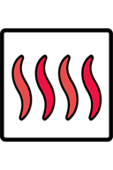 |  **Heater** | Raises the temperature of nearby elements. |
| 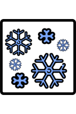 |  **Cooler** | Lowers the temperature of nearby elements. |
| 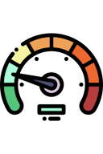 |  **Speedometer** | Displays the speed of an attached element or vehicle. |
| 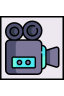 |  **Game Camera** | Makes the game view follow this element, which is useful on moving vehicles. |

## Tips

- Open an element's settings to adjust its range, power, direction, or interval.
- Combine an Element Spawner with a Destroyer to build repeatable test systems.
- Use a Stabilizer and Speedometer when testing vehicles.

## Related Guides

[Building Tutorials](../guides/building-tutorials.md) · [FAQ and Troubleshooting](../guides/faq-and-troubleshooting.md)

## Related Gameplay Systems

[Machines and Automation](../systems/machines-and-automation.md) · [Physics and Forces](../systems/physics-and-forces.md) · [Temperature](../systems/temperature.md)

## Other Element Pages

| Category | Category |
| --- | --- |
| [Building Materials](building-materials.md) | [Chemical Materials](chemical-materials.md) |
| [Explosives](explosives.md) | [Gases](gases.md) |
| [Joints and Connectors](joints-and-connectors.md) | [Liquids](liquids.md) |
| [Objects and Decoration](objects-and-decoration.md) | [Powers](powers.md) |
| [Ragdolls, Body Parts and Ragdoll Chemicals](ragdolls-body-parts-and-chemicals.md) | [Terrain](terrain.md) |
| [Weapons, Missiles and Airstrikes](weapons-missiles-and-airstrikes.md) | |
