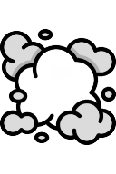
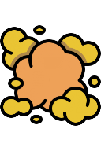
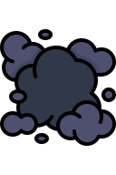
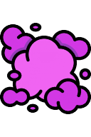
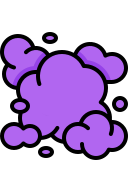
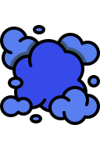
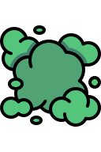
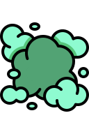
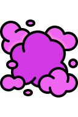
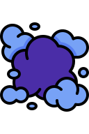

# Gases

[Wiki Home](../README.md) · [All Element Categories](../README.md#explore-the-wiki)

Gases move through open spaces and react differently to heat and ignition. The **Gas Spawner** can continuously create any available gas for experiments or machines.

## Gas Elements

| Icon | Element | Description |
| :---: | --- | --- |
|  |  **Vapor** | [Water](powers.md#water) vapor that cools down and condenses back into liquid [water](powers.md#water). |
|  |  **Explosive Gas** | A light flammable gas that produces a small blast when ignited. |
|  |  **Propane** | A highly flammable fuel gas that creates a medium explosion. |
|  |  **Acetylene** | A very unstable and highly flammable gas that produces a large explosion. |
|  |  **Firework Gas** | A group of special gases that create colorful effects when they explode. |
|  |  **Helium** | An extremely light, inert, and non-flammable gas that can lift elements. |
|  |  **Plasma** | A superheated ionized gas that is extremely hot but not flammable or explosive. |
|  |  **Nitrogen** | A cold, inert, and non-flammable gas that can [freeze](powers.md#freeze) materials. |
|  |  **Hydrogen** | A light, flammable gas for ignition experiments. |
|  |  **Neon** | A non-flammable gas with a glowing particle effect. |
|  |  **Argon** | A non-flammable gas with a distinct glowing particle effect. |
|  |  **Xenon** | A non-flammable gas with its own glowing particle effect. |

## Gas Tool

| Icon | Element | Description |
| :---: | --- | --- |
|  |  **Gas Spawner** | Periodically creates the gas selected in its settings. |

## Tips

- Use enclosed spaces to observe how gases spread and collect.
- Keep ignition sources away from flammable gases until the setup is complete.
- Combine Vapor with heating and cooling to create a water-cycle experiment.

## Related Guides

[Getting Started](../guides/getting-started.md) · [FAQ and Troubleshooting](../guides/faq-and-troubleshooting.md)

## Related Gameplay Systems

[Temperature](../systems/temperature.md) · [Machines and Automation](../systems/machines-and-automation.md)

## Other Element Pages

| Category | Category |
| --- | --- |
| [Building Materials](building-materials.md) | [Chemical Materials](chemical-materials.md) |
| [Explosives](explosives.md) | [Functional Elements](functional-elements.md) |
| [Joints and Connectors](joints-and-connectors.md) | [Liquids](liquids.md) |
| [Objects and Decoration](objects-and-decoration.md) | [Powers](powers.md) |
| [Ragdolls, Body Parts and Ragdoll Chemicals](ragdolls-body-parts-and-chemicals.md) | [Terrain](terrain.md) |
| [Weapons, Missiles and Airstrikes](weapons-missiles-and-airstrikes.md) | |
