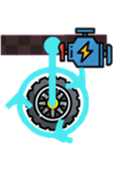
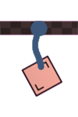
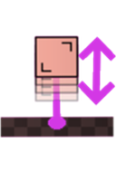
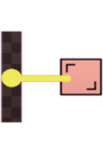
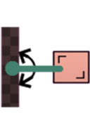
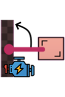

# Joints and Connectors

[Wiki Home](../README.md) · [All Element Categories](../README.md#explore-the-wiki)

Joints connect elements while controlling how they may move relative to each other. Most joints must be placed while the simulation is paused. Their advanced settings can control motor power, speed, length, angle, or breaking resistance.

## Joints

| Icon | Element | Description |
| :---: | --- | --- |
|  |  **Human Joint** | Connects [body parts](ragdolls-body-parts-and-chemicals.md#body-part-sets) to build a custom ragdoll and can limit rotation and joint resistance. |
|  |  **Powered Wheel Joint** | Connects a wheel to another element and rotates it with a motor. |
|  |  **Wheel Joint** | Connects a wheel to another element while allowing it to rotate freely. |
|  |  **Rope** | Connects two elements with a flexible rope and limits their maximum distance. |
|  |  **Piston** | Connects two elements and moves the second element back and forth. |
|  |  **Rod** | Creates a solid connection that keeps two elements at a fixed distance. |
|  |  **Flexible Rod** | Keeps two elements at a fixed distance while allowing the second element to rotate. |
|  |  **Powered Rod** | Uses a motor to rotate the second element around the first at a fixed distance. |
|  |  **Bolt** | Pins an element to the background; it remains in place but can rotate. |
|  |  **Powered Bolt** | Pins an element to the background and rotates it with a motor. |

The Human Joint is listed as a reference for custom bodies; its availability varies by game version. Predefined ragdolls can be used when body-part tools are unavailable.

## Tips

- Select the supporting element first and the moving element second when a joint distinguishes between them.
- Use Wheel Joints for free-spinning [wheels](objects-and-decoration.md#physics-objects) and Powered Wheel Joints for driven [wheels](objects-and-decoration.md#physics-objects).
- Increase joint resistance for heavy machines and reduce it for constructions designed to break apart.
- Test motors at low speed before increasing their power.

## Related Guides

[Building Tutorials](../guides/building-tutorials.md) · [Controls and Tools](../guides/controls-and-tools.md)

## Related Gameplay Systems

[Building and Connections](../systems/building-and-connections.md) · [Machines and Automation](../systems/machines-and-automation.md) · [Ragdolls and Chemicals](../systems/ragdolls-and-chemicals.md)

## Other Element Pages

| Category | Category |
| --- | --- |
| [Building Materials](building-materials.md) | [Chemical Materials](chemical-materials.md) |
| [Explosives](explosives.md) | [Functional Elements](functional-elements.md) |
| [Gases](gases.md) | [Liquids](liquids.md) |
| [Objects and Decoration](objects-and-decoration.md) | [Powers](powers.md) |
| [Ragdolls, Body Parts and Ragdoll Chemicals](ragdolls-body-parts-and-chemicals.md) | [Terrain](terrain.md) |
| [Weapons, Missiles and Airstrikes](weapons-missiles-and-airstrikes.md) | |
