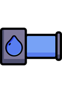
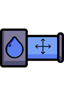
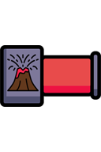
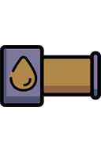
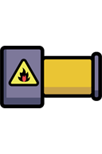
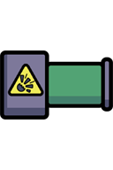
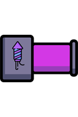
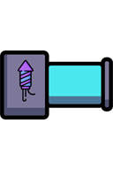
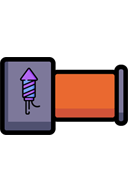
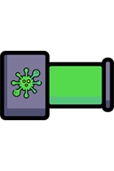

# Liquids

[Wiki Home](../README.md) · [All Element Categories](../README.md#explore-the-wiki)

Liquid spawners continuously add a selected liquid to the sandbox. Their output can be adjusted in the element settings, making them useful for filling containers, creating flows, and building automated experiments.

For direct drawing, see [Liquid Powers](powers.md#liquid-powers), including Water, Lava, fuels, Colored Liquid, and elastic liquids. This page lists their continuous spawner tools.

## Liquid Spawners

| Icon | Element | Description |
| :---: | --- | --- |
|  |  **Water Spawner** | Continuously creates cold [water](powers.md#water) that interacts with [fire](powers.md#fire), [lava](powers.md#lava), and [ragdolls](ragdolls-body-parts-and-chemicals.md) and can evaporate. |
|  |  **Movable Water Spawner** | A movable version of the [Water Spawner](#water-spawner) that can be attached to constructions. |
|  |  **Lava Spawner** | Creates hot [lava](powers.md#lava) that can ignite elements and turn into stone when cooled. |
|  |  **Colored Liquid Spawner** | Creates liquid in a selected color; different colors can mix. |
|  |  **Oil Spawner** | Creates [oil](powers.md#oil) that burns when ignited by [fire](powers.md#fire), [lava](powers.md#lava), or another heat source. |
|  |  **Petrol Spawner** | Creates [petrol](powers.md#petrol) that explodes when ignited. |
|  |  **Nitro Spawner** | Creates highly explosive [nitro](powers.md#nitro) that detonates violently when ignited. |
|  |  **Fireworks Spawner 1** | Creates the first fireworks liquid, which produces a colorful effect when ignited. |
|  |  **Fireworks Spawner 2** | Creates the second fireworks liquid with a different colorful effect. |
|  |  **Fireworks Spawner 3** | Creates the third fireworks liquid with another colorful effect. |
|  |  **Virus Spawner** | Creates [virus](powers.md#virus) particles that multiply over time and infect [ragdolls](ragdolls-body-parts-and-chemicals.md) on contact. |

## Tips

- Place a spawner above a container to create a continuous supply.
- Use the movable spawner on vehicles or machines that need to release [water](powers.md#water) while moving.
- Keep flammable or explosive liquids away from heat until the experiment is ready.
- Combine spawners with filters, teleporters, and moving elements to automate liquid transport.

## Related Guides

[Getting Started](../guides/getting-started.md) · [Building Tutorials](../guides/building-tutorials.md)

## Related Gameplay Systems

[Liquid Physics](../systems/liquid-physics.md) · [Temperature](../systems/temperature.md) · [Machines and Automation](../systems/machines-and-automation.md)

## Other Element Pages

| Category | Category |
| --- | --- |
| [Building Materials](building-materials.md) | [Chemical Materials](chemical-materials.md) |
| [Explosives](explosives.md) | [Functional Elements](functional-elements.md) |
| [Gases](gases.md) | [Joints and Connectors](joints-and-connectors.md) |
| [Objects and Decoration](objects-and-decoration.md) | [Powers](powers.md) |
| [Ragdolls, Body Parts and Ragdoll Chemicals](ragdolls-body-parts-and-chemicals.md) | [Terrain](terrain.md) |
| [Weapons, Missiles and Airstrikes](weapons-missiles-and-airstrikes.md) | |
