# Objects and Decoration

[Wiki Home](../README.md) · [All Element Categories](../README.md#explore-the-wiki)

Objects provide ready-made physical parts, props, furniture, scenery, and themed decorations. Numbered entries are visual or size variants of the same general object. This page groups matching variants together to keep the reference compact while still listing every available object.

## Physics Objects

| Icons | Elements | Description |
| :---: | --- | --- |
| 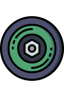 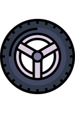 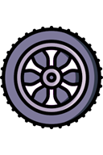 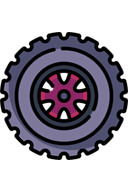   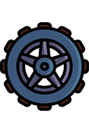 |  **32px Wheel, 48px Wheel, 64px Wheel, 80px Wheel, 96px Wheel** | Wheels in five sizes for vehicles, machines, and rotating constructions. |
| 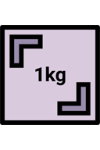 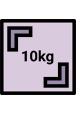 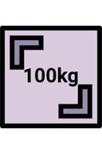 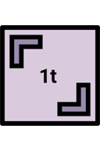   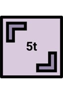 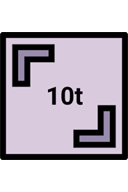 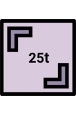 |  **1kg / 2lbs, 10kg / 22lbs, 100kg / 220lbs, 1t / 2200lbs, 5t / 12000lbs, 10t / 22000lbs, 25t / 55000lbs** | Weighted boxes for testing impacts, lifting systems, buoyancy, and structural strength. |
| 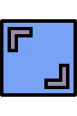 |  **Slippery Box** | A low-friction box that slides easily. |
| 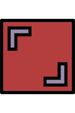 |  **Non-slippery Box** | A high-friction box that resists sliding. |
| 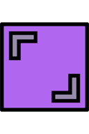 |  **Bouncy Box** | A box with high bounce. |
| 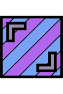 |  **Bouncy and Slippery Box** | Combines strong bounce with low friction. |
|  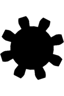 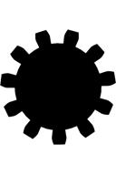 |  **Gear: 5 Teeth, Gear: 8 Teeth, Gear: 11 Teeth** | Three gear sizes for mechanisms and powered assemblies. |
|  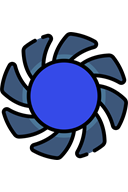 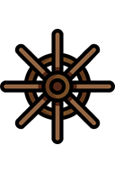 |  **Turbine Shovel 1, 2, and 3** | Three blade shapes for turbines, paddles, and rotating machines. |
|  |  **Marble** | A small round object that rolls and reacts strongly to slopes and impacts. |

## Handheld and Melee Objects

| Icons | Elements | Description |
| :---: | --- | --- |
| 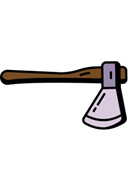 |  **Axe** | A sharp melee object that can injure [ragdolls](ragdolls-body-parts-and-chemicals.md) on a hard impact. |
| 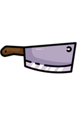 |  **Butcher Knife** | A heavy sharp blade that can injure [ragdolls](ragdolls-body-parts-and-chemicals.md). |
| 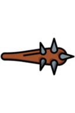 |  **Club** | A blunt handheld object for impacts. |
| 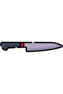 |  **Knife** | A small sharp object that can injure [ragdolls](ragdolls-body-parts-and-chemicals.md). |

## Materials and Cargo

| Icons | Elements | Description |
| :---: | --- | --- |
| 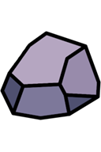 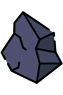 |  **Stone 1–2** | Two stone props for ballast, impacts, or decoration. |
| 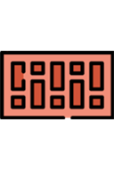 |  **Brick** | A small construction and decoration prop. |
| 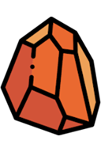  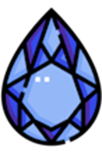 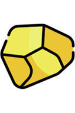 |  **Bronze, Ruby, Sapphire, Gold** | Metal and gemstone valuables for cargo or decorative scenes. |
| 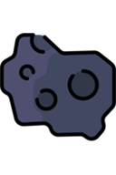 |  **Coal** | A combustible piece of [coal](chemical-materials.md#coal) used as cargo or fuel-themed decoration. |
| 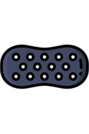 |  **Rubber** | A rubber material prop. |
| 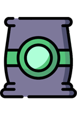 |  **Cement** | A heavy construction-material prop. |
| 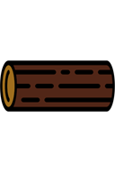 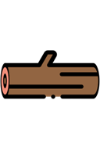 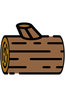 |  **Wood 1–3** | Three wooden cargo and construction props. |
| 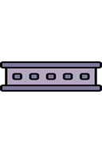 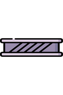 |  **Steel 1–2** | Two steel cargo and construction props. |
| 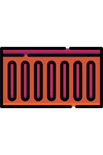 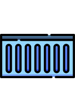 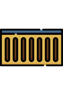 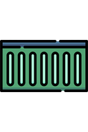   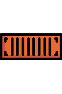 |  **Container 1–5** | Five cargo-container variants for ships, vehicles, and storage areas. |
| 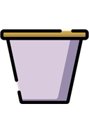 |  **Big Bucket** | A large open container that can hold objects or liquid. |
| 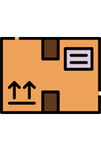 |  **Package** | A compact cargo parcel. |
| 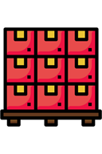 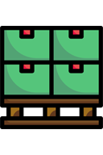 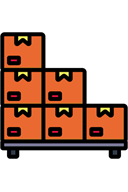 |  **Pallet 1–3** | Three pallet variants for cargo scenes. |
| 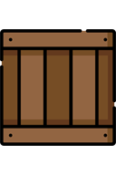 |  **Wooden Box** | A general-purpose wooden crate. |
| 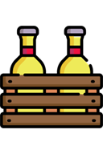   |  **Beer-Box 1–3** | Three beverage-crate variants. |
|  |  **Bollard** | A short post suited to streets, docks, and barriers. |

## Lights and Equipment

| Icons | Elements | Description |
| :---: | --- | --- |
|  |  **Electric Generator** | A generator prop for industrial or machine scenes. |
|  |  **Alarm Light** | A warning-light prop. |
|  |  **Radar** | A radar prop for ships and control stations. |
|  |  **Floodlight** | A large directional light prop. |
|   |  **Lantern, Lantern 2** | Two portable lantern variants. |
|  |  **Campfire** | A burning outdoor [fire](powers.md#fire) and heat source. |
|  |  **Torch** | A portable burning light and ignition source. |
|  |  **Flashlight** | A small directional light. |

## Furniture and Household Objects

| Icons | Elements | Description |
| :---: | --- | --- |
|  |  **Bed** | A bed for indoor scenes. |
|  |  **Bookcase** | A tall furniture prop. |
|     |  **Chair 1–2, Armchair, Couch** | Seating in several shapes and sizes. |
|     |  **Closet, Chest, Case, Locker** | Storage furniture and containers. |
|  |  **Cooker** | A kitchen appliance prop. |
|  |  **Rum** | A bottle used as cargo or decoration. |
|  |  **Ship in a Bottle** | A nautical display object. |
|  |  **Dish Shelf** | A shelf with dishes for interior scenes. |
|  |  **Globe** | A decorative globe. |
|   |  **Old TV, Modern TV** | Two television styles. |
|   |  **Trash, Waste Container** | Waste props in two sizes. |
|  |  **Vase** | A decorative vase for indoor scenes. |
|  |  **Washing Machine** | A heavy household appliance. |
|    |  **Table 1–2, Bench** | Two tables and an outdoor bench. |
|  |  **Street Lantern** | A tall outdoor lighting prop. |

## Nature and Underwater Decoration

| Icons | Elements | Description |
| :---: | --- | --- |
|        |  **Tree 1–5** | Five tree variants for natural environments. |
|   |  **Seaweed 1–2** | Two underwater plant variants. |
|  |  **Coral** | An underwater coral decoration. |
|        |  **Plant 1–5** | Five decorative plant variants. |
|    |  **Seashell 1–3** | Three shell variants for beaches and underwater scenes. |
|  |  **Seastar** | A sea-star decoration. |
|   |  **Fossil 1–2** | Two fossil variants. |
|  |  **Oyster** | An underwater shellfish prop. |
|     |  **Lobster, Blowfish, Octopus, Shark** | Four marine-creature props. |
|  |  **Parrot** | A bird prop for pirate and tropical scenes. |

## Themed and Nautical Objects

| Icons | Elements | Description |
| :---: | --- | --- |
|  |  **Pirate Head** | A pirate-themed head prop. |
|    |  **Skull 1, Skull 2, Skull Head** | Three skull decorations. |
|    |  **Tombstone, Coffin, Pumpkin** | Graveyard and seasonal props. |
|  |  **Coin** | A small treasure object. |
|  |  **Aqualung** | Diving equipment for underwater scenes. |
|    |  **Spyglass, Binoculars, Compass** | Navigation and observation props. |
|   |  **Captain Hat, Pirate Hook** | Wearable-looking nautical props. |
|    |  **Rubber Ring, Surfboard, Vest** | Water-sport and flotation props. |
|  |  **Pirate Flag** | A flag for pirate ships and bases. |
|    |  **Pirate Map 1–3** | Three treasure-map variants. |
|  |  **Anchor** | A heavy nautical object for ships and docks. |
|  |  **Fender** | A protective ship-side object. |
|  |  **Rudder** | A steering-themed part for boats and ships. |
|  |  **Rope** | A coiled rope prop for nautical scenes. |

## Tips

- Use weighted boxes to compare buoyancy and structural strength.
- Combine wheels, gears, and turbine shovels with powered joints to build machines.
- Decorative objects still participate in physics and can be attached to constructions.

## Related Guides

[Building Tutorials](../guides/building-tutorials.md) · [Saving and Loading](../guides/saving-and-loading.md)

## Related Gameplay Systems

[Physics and Forces](../systems/physics-and-forces.md) · [Building and Connections](../systems/building-and-connections.md) · [Machines and Automation](../systems/machines-and-automation.md)

## Other Element Pages

| Category | Category |
| --- | --- |
| [Building Materials](building-materials.md) | [Chemical Materials](chemical-materials.md) |
| [Explosives](explosives.md) | [Functional Elements](functional-elements.md) |
| [Gases](gases.md) | [Joints and Connectors](joints-and-connectors.md) |
| [Liquids](liquids.md) | [Powers](powers.md) |
| [Ragdolls, Body Parts and Ragdoll Chemicals](ragdolls-body-parts-and-chemicals.md) | [Terrain](terrain.md) |
| [Weapons, Missiles and Airstrikes](weapons-missiles-and-airstrikes.md) | |
