# Powers

[Wiki Home](../README.md) · [All Element Categories](../README.md#explore-the-wiki)

Powers act directly on the sandbox instead of remaining as physical objects. Standard Powers manipulate elements and the environment, while Liquid Powers draw liquid materials directly into the scene.

## Standard Powers

| Icon | Element | Description |
| :---: | --- | --- |
|  |  **Eraser** | Deletes elements and liquids from the sandbox. |
|  |  **Fire** | Ignites elements and detonates suitable [explosives](explosives.md). |
| 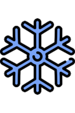 |  **Freeze** | Cools an area, extinguishes fire, turns lava into stone, and can harm [ragdolls](ragdolls-body-parts-and-chemicals.md). |
|  |  **Explosion** | Creates an explosion at the selected position. |
|  |  **Attract** | Pulls nearby elements toward the selected position. |
|  |  **Finger (Circle)** | Interacts physically with elements using a circular contact area. |
|  |  **Finger (Rectangle)** | Interacts physically with elements using a rectangular contact area. |
|  |  **Finger (Rectangle 2)** | Provides a second rectangular shape for physically moving elements. |
|  |  **Liquid Painter** | Changes the color of liquid particles touched by the brush. |
| 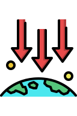 |  **Change Gravity** | Changes the sandbox's gravity to the direction of the swipe. |
|  |  **Tsunami** | Generates a large wave across the sandbox. |
|  |  **Rain** | Creates falling water over an area. |
|  |  **Wind** | Applies directional wind force to the sandbox. |

## Liquid Powers

| Icon | Element | Description |
| :---: | --- | --- |
| 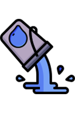 |  **Water** | Draws cold water that interacts with fire, lava, and [ragdolls](ragdolls-body-parts-and-chemicals.md) and can evaporate. |
| 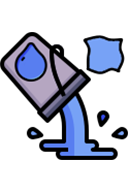 |  **Elastic Water** | Draws connected water particles that form soft, jelly-like shapes. |
| 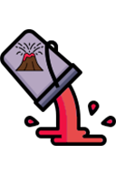 |  **Lava** | Draws hot lava that can ignite elements and become stone when cooled. |
| 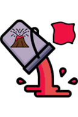 |  **Elastic Lava** | Draws connected lava particles that form hot, jelly-like shapes. |
|  |  **Colored Liquid** | Draws liquid in a selected color that can mix with other colors. |
|  |  **Oil** | Draws a flammable liquid that burns after ignition. |
| 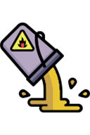 |  **Petrol** | Draws a flammable liquid that explodes after ignition. |
| 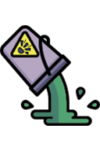 |  **Nitro** | Draws a highly explosive liquid that detonates violently after ignition. |
| 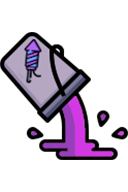 |  **Fireworks 1** | Draws the first fireworks liquid, which creates a colorful effect when ignited. |
| 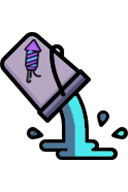 |  **Fireworks 2** | Draws the second fireworks liquid with a different effect. |
| 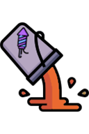 |  **Fireworks 3** | Draws the third fireworks liquid with another effect. |
| 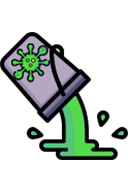 |  **Virus** | Draws virus particles that multiply and infect [ragdolls](ragdolls-body-parts-and-chemicals.md) on contact. |

## Tips

- Pause the simulation when precise placement is important.
- Use smaller brush sizes for controlled liquid experiments.
- Combine Change Gravity, Wind, Rain, and Tsunami to create environmental scenarios.

## Related Guides

[Getting Started](../guides/getting-started.md) · [Controls and Tools](../guides/controls-and-tools.md)

## Related Gameplay Systems

[Liquid Physics](../systems/liquid-physics.md) · [Temperature](../systems/temperature.md) · [Physics and Forces](../systems/physics-and-forces.md) · [Destruction, Explosions and Weapons](../systems/destruction-explosions-and-weapons.md)

## Other Element Pages

| Category | Category |
| --- | --- |
| [Building Materials](building-materials.md) | [Chemical Materials](chemical-materials.md) |
| [Explosives](explosives.md) | [Functional Elements](functional-elements.md) |
| [Gases](gases.md) | [Joints and Connectors](joints-and-connectors.md) |
| [Liquids](liquids.md) | [Objects and Decoration](objects-and-decoration.md) |
| [Ragdolls, Body Parts and Ragdoll Chemicals](ragdolls-body-parts-and-chemicals.md) | [Terrain](terrain.md) |
| [Weapons, Missiles and Airstrikes](weapons-missiles-and-airstrikes.md) | |
