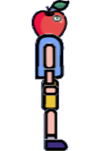
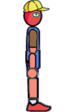
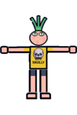
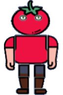
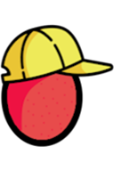
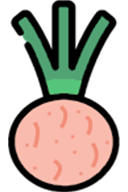
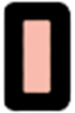
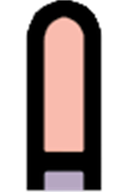
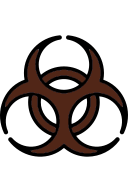

# Ragdolls, Body Parts and Ragdoll Chemicals

[Wiki Home](../README.md) · [All Element Categories](../README.md#explore-the-wiki)

Ragdolls are physics-driven characters that react to impacts, liquids, temperature, weapons, and chemicals. Use predefined ragdolls for quick experiments or combine body parts with [Human Joints](joints-and-connectors.md#human-joint) to create custom characters.

## Predefined Ragdolls

| Icon | Element | Description |
| :---: | --- | --- |
|  |  **Standing Apple** | A complete standing Apple ragdoll ready to place in the sandbox. |
|  |  **Standing Bob** | A complete standing Bob ragdoll ready to place in the sandbox. |
|  |  **Standing Onion** | A complete standing Onion ragdoll ready to place in the sandbox. |
|  |  **Standing Tomato** | A complete standing Tomato ragdoll ready to place in the sandbox. |

## Body-Part Sets

| Icon | Set | Description |
| :---: | --- | --- |
|  |  **Ragdoll Body Part: Apple** | Apple-themed body parts for building a custom ragdoll. |
|  |  **Ragdoll Body Part: Lemon** | Lemon-themed body parts for building a custom ragdoll. |
|  |  **Ragdoll Body Part: Tomato** | Tomato-themed body parts for building a custom ragdoll. |
|  |  **Ragdoll Body Part: Onion** | Onion-themed body parts for building a custom ragdoll. |

Body-part tools are version-dependent. The following reference covers the parts in each set; use the predefined ragdolls if custom-body tools are unavailable in your version:

| Icon | Body Part | Description |
| :---: | --- | --- |
|     |  **Head** | The ragdoll's head. |
|     |  **Body 1** | The first torso section. |
|     |  **Body 2** | The second torso section. |
|     |  **Body 3** | The third torso section. |
|     |  **Upper Arm** | The upper section of an arm. |
|     |  **Lower Arm** | The lower section of an arm. |
|     |  **Hand** | A hand attached to a lower arm. |
|     |  **Upper Leg** | The upper section of a leg. |
|     |  **Lower Leg** | The lower section of a leg. |
|     |  **Foot** | A foot attached to a lower leg. |

Body parts can be crushed and bleed. Connect them with **[Human Joints](joints-and-connectors.md#human-joint)**, placing the torso or supporting part as Element 1 and the attached limb as Element 2.

## Ragdoll Chemicals

| Icon | Element | Description |
| :---: | --- | --- |
|  |  **"Virus" Chemical** | Infects the selected ragdoll with a [virus](powers.md#virus). |
|  |  **"Bomb" Chemical** | Causes the affected ragdoll to explode. |
|  |  **"Crazy" Chemical** | Makes the ragdoll behave erratically. |
|  |  **"Godlike" Chemical** | Makes the ragdoll immortal. |
|  |  **"Burn" Chemical** | Sets the ragdoll on [fire](powers.md#fire). |
|  |  **"Tear" Chemical** | Causes the ragdoll to tear apart. |
|  |  **"Aggressive" Chemical** | Makes the ragdoll aggressive. |
|  |  **"Paralyze" Chemical** | Paralyzes the ragdoll. |
|  |  **"Rocket" Chemical** | Launches the ragdoll into the air. |

## Tips

- Pause the simulation before assembling a custom ragdoll.
- Adjust [Human Joint](joints-and-connectors.md#human-joint) angle limits and resistance to control movement and durability.
- Apply one chemical at a time when comparing its effects.

## Related Guides

[FAQ and Troubleshooting](../guides/faq-and-troubleshooting.md)

## Related Gameplay Systems

[Ragdolls and Chemicals](../systems/ragdolls-and-chemicals.md) · [Building and Connections](../systems/building-and-connections.md) · [Temperature](../systems/temperature.md)

## Other Element Pages

| Category | Category |
| --- | --- |
| [Building Materials](building-materials.md) | [Chemical Materials](chemical-materials.md) |
| [Explosives](explosives.md) | [Functional Elements](functional-elements.md) |
| [Gases](gases.md) | [Joints and Connectors](joints-and-connectors.md) |
| [Liquids](liquids.md) | [Objects and Decoration](objects-and-decoration.md) |
| [Powers](powers.md) | [Terrain](terrain.md) |
| [Weapons, Missiles and Airstrikes](weapons-missiles-and-airstrikes.md) | |
