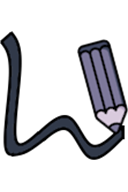
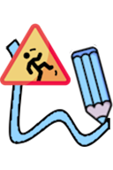
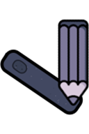
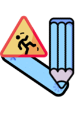
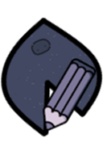
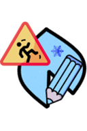

# Terrain

[Wiki Home](../README.md) · [All Element Categories](../README.md#explore-the-wiki)

Terrain forms fixed boundaries, floors, ramps, and containers. Each terrain material is available in three drawing modes: freeform edge, straight line, and polygon.

## Freeform Terrain

| Icon | Element | Description |
| :---: | --- | --- |
|  |  **Stone Terrain (Edge)** | Draws solid stone terrain in a freeform shape. |
|  |  **Slippery Terrain (Edge)** | Draws very slippery terrain in a freeform shape. |
|  |  **Rubber Terrain (Edge)** | Draws very bouncy rubber terrain in a freeform shape. |

## Straight Terrain

| Icon | Element | Description |
| :---: | --- | --- |
|  |  **Stone Terrain (Line)** | Creates a straight solid stone boundary. |
|  |  **Slippery Terrain (Line)** | Creates a straight, very slippery boundary. |
|  |  **Rubber Terrain (Line)** | Creates a straight, very bouncy boundary. |

## Polygon Terrain

| Icon | Element | Description |
| :---: | --- | --- |
|  |  **Stone Terrain (Polygon)** | Creates a closed solid stone shape. |
|  |  **Slippery Terrain (Polygon)** | Creates a closed shape with a very slippery surface. |
|  |  **Rubber Terrain (Polygon)** | Creates a closed shape with a very bouncy surface. |

## Tips

- Use Line terrain for floors and ramps and Polygon terrain for large solid areas.
- Build closed basins before adding liquids.
- Mix terrain materials to create surfaces with different friction and bounce behavior.

## Related Guides

[Getting Started](../guides/getting-started.md) · [Building Tutorials](../guides/building-tutorials.md)

## Related Gameplay Systems

[Building and Connections](../systems/building-and-connections.md) · [Physics and Forces](../systems/physics-and-forces.md) · [Liquid Physics](../systems/liquid-physics.md)

## Other Element Pages

| Category | Category |
| --- | --- |
| [Building Materials](building-materials.md) | [Chemical Materials](chemical-materials.md) |
| [Explosives](explosives.md) | [Functional Elements](functional-elements.md) |
| [Gases](gases.md) | [Joints and Connectors](joints-and-connectors.md) |
| [Liquids](liquids.md) | [Objects and Decoration](objects-and-decoration.md) |
| [Powers](powers.md) | [Ragdolls, Body Parts and Ragdoll Chemicals](ragdolls-body-parts-and-chemicals.md) |
| [Weapons, Missiles and Airstrikes](weapons-missiles-and-airstrikes.md) | |
