# Weapons, Missiles and Airstrikes

[Wiki Home](../README.md) · [All Element Categories](../README.md#explore-the-wiki)

Weapons fire projectiles from placed objects, missiles provide different payloads and flight behavior, and airstrikes attack a selected area from outside the scene. Placed weapons can be fired manually or configured for automatic fire.

## Weapons

| Icon | Element | Description |
| :---: | --- | --- |
| 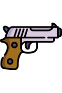 |  **Pistol** | A compact firearm that shoots single bullets. |
| 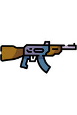 |  **AK-47** | A rapid-fire automatic weapon. |
| 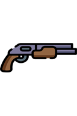 |  **Shotgun** | Fires a spread of projectiles at short range. |
| 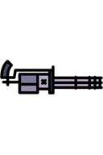 |  **Minigun** | Fires bullets at a very high rate. |
| 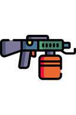 |  **Flamethrower** | Projects [fire](powers.md#fire) that ignites and heats nearby materials. |
| 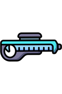 |  **Ice Gun** | Fires freezing projectiles that cool targets. |
| 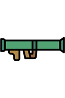 |  **Bazooka** | Launches an explosive missile. |
| 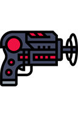 |  **Black Hole Gun** | Fires a projectile that creates a black-hole effect. |
|  |  **Impulse Gun** | Applies a strong physical impulse to targets. |
| 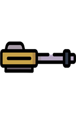 |  **Railgun** | Fires a fast, powerful projectile. |
| 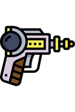 |  **Proton Gun** | Fires a special energy projectile. |
| 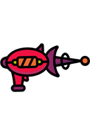 |  **Lava Gun** | Fires hot [lava](powers.md#lava) projectiles. |
|  |  **Laser Gun** | Fires a directed laser beam. |

## Missiles

| Icon | Element | Description |
| :---: | --- | --- |
|  |  **Dart** | A small and weak missile. |
| 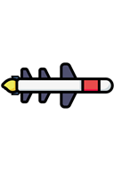 |  **Viper** | A medium-sized missile. |
| 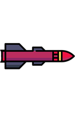 |  **Colossus** | A large and strong missile. |
| 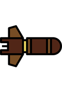 |  **Shrapnel** | A missile that creates multiple explosions. |
| 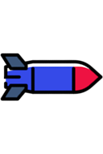 |  **Deluge** | Releases [water](powers.md#water) when it explodes. |
| 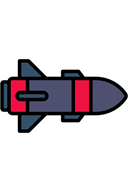 |  **Inferno** | Releases [lava](powers.md#lava) when it explodes. |
| 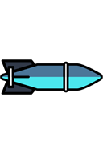 |  **Blizzard** | Creates [ice](chemical-materials.md#ice) when it explodes. |
| 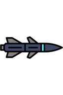 |  **Vortex** | Creates a black hole at the end of its flight. |
|  |  **Ragdoll Finder** | A guided missile that aims for [ragdolls](ragdolls-body-parts-and-chemicals.md). |

## Airstrikes

| Icon | Element | Description |
| :---: | --- | --- |
|  |  **Meteor** | Calls down a meteor onto the selected area. |
| 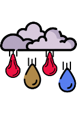 |  **Liquid Airstrike** | Drops a selected liquid such as [water](powers.md#water), [lava](powers.md#lava), or [oil](powers.md#oil) from above. |
| 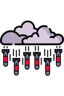 |  **Missile Airstrike** | Bombards an area with a selected missile type. |
| 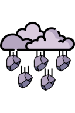 |  **Element Airstrike** | Drops selected objects such as stones, torches, or metals. |
| 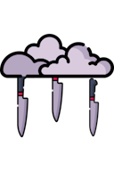 |  **Knife Airstrike** | Drops melee objects such as knives, axes, and clubs. |
| 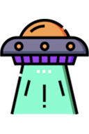 |  **Tractor Beam** | Applies a large beam that pulls elements in the selected area. |
| 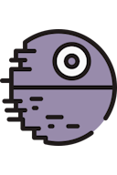 |  **Death Star Laser** | Fires a powerful laser strike into the sandbox. |

## Tips

- Enable automatic fire when mounting a weapon on a vehicle or defensive structure.
- Leave enough distance behind a weapon for recoil and moving parts.
- Airstrikes are most useful on large maps with enough open space above the target.

## Related Guides

[Controls and Tools](../guides/controls-and-tools.md) · [FAQ and Troubleshooting](../guides/faq-and-troubleshooting.md)

## Related Gameplay Systems

[Destruction, Explosions and Weapons](../systems/destruction-explosions-and-weapons.md) · [Ragdolls and Chemicals](../systems/ragdolls-and-chemicals.md)

## Other Element Pages

| Category | Category |
| --- | --- |
| [Building Materials](building-materials.md) | [Chemical Materials](chemical-materials.md) |
| [Explosives](explosives.md) | [Functional Elements](functional-elements.md) |
| [Gases](gases.md) | [Joints and Connectors](joints-and-connectors.md) |
| [Liquids](liquids.md) | [Objects and Decoration](objects-and-decoration.md) |
| [Powers](powers.md) | [Ragdolls, Body Parts and Ragdoll Chemicals](ragdolls-body-parts-and-chemicals.md) |
| [Terrain](terrain.md) | |
