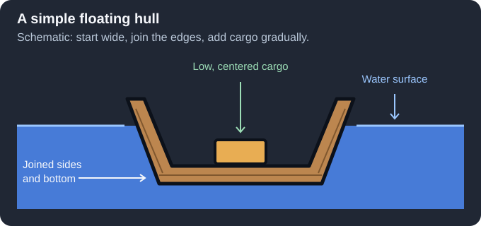
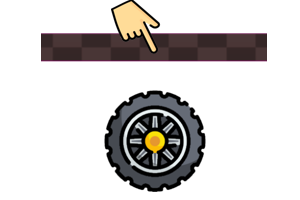
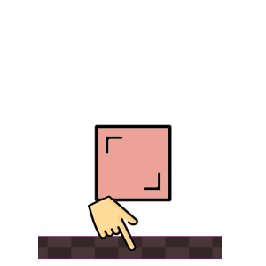

# Building Tutorials

[Wiki Home](../README.md) · [Elements and Gameplay Systems](../README.md#explore-the-wiki)

These three small projects introduce floating constructions, powered wheels, and repeating motion. Pause while assembling parts, start with low power, and test before adding decoration.

## Build a Floating Boat

*Building schematic, not an in-game screenshot. Join the hull edges and keep cargo low and centered.*

1. Open a basin scene and add [Water](../elements/powers.md#water), leaving room for waves.
2. Pause and use [Wood (Line)](../elements/building-materials.md#wood-line) to make a wide, shallow U-shaped hull above the surface. Join the base and sides without gaps.
3. Resume and let it settle before adding anything else.
4. Pause and add a small cargo object near the center, then resume.
5. Compare the unloaded and loaded boat. Try a small wave once it floats steadily.
6. [Save the complete hull as an Object](saving-and-loading.md#save-an-object) and the basin experiment as a Simulation.

If it sinks or rolls over, remove cargo, widen the hull, check for gaps, and keep the center of mass low. Check [Liquid Physics](../systems/liquid-physics.md) before changing particle weight.

## Build a Powered Car

*Connect the chassis first and each wheel second.*

1. Create flat [Stone Terrain](../elements/terrain.md), then pause.
2. Place a short wooden chassis and two [wheels](../elements/objects-and-decoration.md#physics-objects) below it, with room to rotate.
3. Use a [Powered Wheel Joint](../elements/joints-and-connectors.md#powered-wheel-joint) from the chassis to the center of each wheel.
4. Set a low motor speed and enough power to turn the wheels. Configure them to drive in the same direction.
5. Resume. If the car tilts, lower or balance its load; if a wheel cannot turn, check its connection and clearance.
6. Add a [Speedometer](../elements/functional-elements.md#speedometer) for comparison, then save the complete car.

See [Building and Connections](../systems/building-and-connections.md) and [Physics and Forces](../systems/physics-and-forces.md) for joint order and traction.

## Build a Repeating Piston Machine

*A fixed support lets the piston move a separate part back and forth.*

1. Pause and place a base and a separate moving block.
2. Pin the base to the background at two separated points with [Bolts](../elements/joints-and-connectors.md#bolt), so it cannot rotate around a single pivot.
3. Connect the base as Element 1 and the moving block as Element 2 using a [Piston](../elements/joints-and-connectors.md#piston).
4. Open the piston settings and choose a modest movement range and speed.
5. Resume and watch the block travel. Give it enough clearance to avoid hitting the base or terrain.
6. Save the assembly, then experiment with using its motion to push another object.

See [Machines and Automation](../systems/machines-and-automation.md) for spawners, repeating movement, and liquid processing. If a project fails to behave as expected, use [FAQ and Troubleshooting](faq-and-troubleshooting.md).

## Other Guides

[Getting Started](getting-started.md) · [Controls and Tools](controls-and-tools.md) · [Saving and Loading](saving-and-loading.md) · [Online Workshop](online-workshop.md) · [FAQ and Troubleshooting](faq-and-troubleshooting.md)

