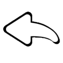

# Controls and Tools

[Wiki Home](../README.md) · [Elements and Gameplay Systems](../README.md#explore-the-wiki)

The sandbox combines element placement, selection tools, camera controls, and simulation controls. Some actions require pause; follow the game's message if an action is currently unavailable.

## Camera and Simulation

On touch devices, use the camera gestures to move the view and pinch to zoom. Deselect tools that capture gestures if camera movement is blocked. On PC, use WASD or middle-mouse dragging to move the camera.

Use Pause/Play to switch between arranging and running a scene. The liquid pause option is configured separately in [Liquid Settings](../systems/liquid-physics.md#liquid-settings).

## Place, Select and Edit

Choose an element category, select an element, and place it in the sandbox. Open its configuration controls to adjust available settings such as size, color, output, motor speed, or timer.

Selection supports moving, rotating, copying, and deleting parts. Use multiple selection when editing a whole construction. Keep all required connected parts together when copying or [saving an Object](saving-and-loading.md#save-an-object).

*Undo reverses supported editing actions.*

Use Undo for supported changes, or [Eraser](../elements/powers.md#eraser) to remove elements and liquids. Check the Eraser's settings before clearing a mixed scene.

## PC Shortcuts

| Input | Action |
| --- | --- |
| WASD | Move the camera. |
| Middle-mouse drag | Pan the camera. |
| Mouse wheel over the sandbox | Zoom; while moving a part, rotate it in 15-degree steps instead. |
| Mouse wheel over a panel | Scroll the panel. |
| Space | Toggle simulation pause. |
| Ctrl+Z | Undo a supported action. |
| C | Toggle the selected element's configuration panel. |
| F | Flip the selected placement where supported. |
| Tab | Toggle the left and right panels. |
| Escape | Deselect or cancel the current placement or movement. |
| R | Open sandbox-size selection. |

These shortcuts are implemented for the Windows version. Touch controls use the on-screen interface.

## Connections and Testing

For joints that distinguish between two elements, select the supporting element first and the moving element second. See [Building and Connections](../systems/building-and-connections.md) for joint types and limits.

Try the [Building Tutorials](building-tutorials.md) to practice editing. If a tool appears unresponsive, check [FAQ and Troubleshooting](faq-and-troubleshooting.md).

## Other Guides

[Getting Started](getting-started.md) · [Saving and Loading](saving-and-loading.md) · [Online Workshop](online-workshop.md) · [Building Tutorials](building-tutorials.md) · [FAQ and Troubleshooting](faq-and-troubleshooting.md)

