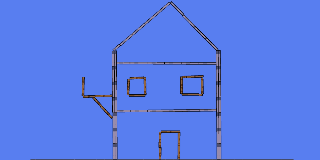

# Building and Connections

[Wiki Home](../README.md) · [Elements](../README.md#explore-the-wiki)

Construction combines physical building pieces with terrain and joints. The material determines how a part behaves; its connections determine how it moves with the rest of the assembly.

## Building Materials and Terrain

[Building Materials](../elements/building-materials.md) include Wood, Stone, Steel, Styrofoam, and Glass, each in line and individual forms. Pause before placing them. New pieces briefly stick to nearby elements, helping form an assembly.

*Building pieces can form complete structures, such as this house from the in-game help.*

[Terrain](../elements/terrain.md) creates fixed floors, ramps, and basins. Freeform edges, straight lines, and polygons provide different drawing methods. Stone, Slippery, and Rubber terrain offer different surface behavior.

See [Physics and Forces](physics-and-forces.md) for mass, friction, and bounce, and [Liquid Physics](liquid-physics.md) for floating constructions.

## Connection Types

| Connection | Purpose |
| --- | --- |
| Rod | Holds two elements at a fixed distance. |
| Flexible Rod | Maintains distance while allowing relative rotation. |
| Rope | Limits maximum separation while allowing slack. |
| Wheel Joint | Allows a connected wheel to rotate freely. |
| Powered Wheel Joint / Powered Rod | Uses a motor to drive relative rotation. |
| Piston | Moves the second element back and forth. |
| Bolt | Pins an element to the background while allowing rotation. |
| Powered Bolt | Pins an element to the background and rotates it with a motor. |
| Human Joint | Connects ragdoll parts with configurable movement limits, where available. |

The [Joints and Connectors](../elements/joints-and-connectors.md) catalog lists every connection.

### Connecting a Wheel

*Choose the supporting body first, then the wheel. A [Powered Wheel Joint](../elements/joints-and-connectors.md#powered-wheel-joint) drives the wheel; a [Wheel Joint](../elements/joints-and-connectors.md#wheel-joint) lets it rotate freely.*

## Order, Limits and Load

Where a tool distinguishes between Element 1 and Element 2, choose the supporting part first and the moving part second. Reversing the order can change the motion.

Available settings vary by joint. Motors have speed and power controls; Human Joints have angle and rigidity controls. Resistance determines how much load a connection can withstand. Heavy loads or impacts can break connections, changing the structure's behavior.

## Powered Constructions

Connect [wheels and gears](../elements/objects-and-decoration.md#physics-objects) to motors, use pistons for reciprocating motion, or attach a [Thruster](../elements/functional-elements.md#thruster) for forward force. See [Machines and Automation](machines-and-automation.md) for combining these parts.

*A [Piston](../elements/joints-and-connectors.md#piston) connects a supporting part and a moving part to produce back-and-forth motion.*

## Try This

Build a small chassis, attach two wheels with Powered Wheel Joints, and test it at low speed. Add cargo and observe traction, stability, and joint load.

## Related Guides

[Controls and Tools](../guides/controls-and-tools.md) · [Building Tutorials](../guides/building-tutorials.md) · [Saving and Loading](../guides/saving-and-loading.md)

## Other Gameplay Systems

[Liquid Physics](liquid-physics.md) · [Temperature](temperature.md) · [Destruction, Explosions and Weapons](destruction-explosions-and-weapons.md) · [Physics and Forces](physics-and-forces.md) · [Machines and Automation](machines-and-automation.md) · [Ragdolls and Chemicals](ragdolls-and-chemicals.md)

