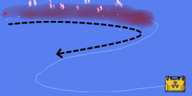
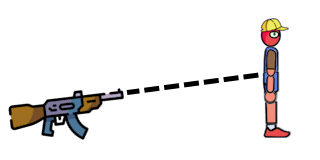

# Destruction, Explosions and Weapons

[Wiki Home](../README.md) · [Elements](../README.md#explore-the-wiki)

Impacts, fire, projectiles, and explosives can damage objects and break constructions apart. The result depends on the target, its material, its connections, and the effect used.

## Structural Damage

A damaged part or broken joint can remove support from an entire assembly. Collisions can cause further damage after the first failure. Fire may consume structural material, while explosions can scatter parts and break their connections.

See [Building and Connections](building-and-connections.md) for connection strength and [Physics and Forces](physics-and-forces.md) for impact behavior.

## Explosion Types

| Type | Examples and behavior |
| --- | --- |
| Blast | Grenade and Nuclear Bomb push and damage surrounding objects. |
| Multiple blasts | Cluster Bomb, Multi Bomb, and Cycle Bomb create several explosions. |
| Implosion | Implosion pulls nearby objects inward. |
| Black hole | Black Hole Bomb attracts objects before its final explosion. |
| Material release | Water, Lava, Oil, Colored Liquid, and Virus Bombs release their named material. |
| Temperature and special effects | Ice Bomb freezes, Vaporizer heats liquids, and Zero Gravity Bomb temporarily changes gravity. |
| Fragments and smoke | Frag Grenade releases shrapnel; Smoke Grenade creates smoke. |

The [Explosives](../elements/explosives.md) catalog includes every bomb, tank, fuse, and firework.

## Detonation and Chain Reactions

*A fuse carries ignition along a path to connect stages of a chain reaction. See [Fuse](../elements/explosives.md#fuse).*

Depending on the element, detonation can be triggered by fire, a timer, or collisions. [Fuse](../elements/explosives.md#fuse) carries ignition between explosives. Released fuel, heat, or fragments can trigger another stage.

Not every blast starts another explosion: TNT's small blast is too weak to start a chain reaction by itself. [Temperature](temperature.md) explains fuel ignition and burning materials.

## Weapons, Missiles and Airstrikes

*Placed weapons fire at targets; projectile type and the target's condition affect the outcome. See [Weapons](../elements/weapons-missiles-and-airstrikes.md#weapons).*

Placed weapons fire manually or automatically. Bullets and shrapnel damage targets through impacts; fire, freezing, impulse, laser, and black-hole weapons apply different effects.

Missiles carry explosive or material payloads. Ragdoll Finder targets ragdolls. Airstrikes deliver missiles, objects, liquids, or beams from above. See [Weapons, Missiles and Airstrikes](../elements/weapons-missiles-and-airstrikes.md).

Ragdoll injuries are described in [Ragdolls and Chemicals](ragdolls-and-chemicals.md).

## Try This

Arrange a short fuse leading to a bomb beside a simple structure. Compare the resulting damage with an impact or fire applied to the same structure.

## Related Guides

[FAQ and Troubleshooting](../guides/faq-and-troubleshooting.md) · [Saving and Loading](../guides/saving-and-loading.md)

## Other Gameplay Systems

[Liquid Physics](liquid-physics.md) · [Temperature](temperature.md) · [Building and Connections](building-and-connections.md) · [Physics and Forces](physics-and-forces.md) · [Machines and Automation](machines-and-automation.md) · [Ragdolls and Chemicals](ragdolls-and-chemicals.md)

