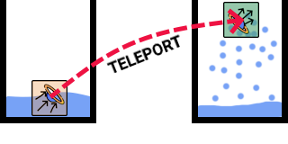
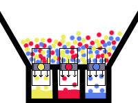

# Machines and Automation

[Wiki Home](../README.md) · [Elements](../README.md#explore-the-wiki)

Machines combine connected parts, forces, and repeated actions into a working construction. Automation uses spawners and processing tools to keep an experiment running without placing each object manually.

## Motors and Movement

Powered joints turn wheels and linked parts; pistons produce back-and-forth motion. Thrusters propel a construction, while Stabilizers help keep it upright. See [Building and Connections](building-and-connections.md) for assembly and [Physics and Forces](physics-and-forces.md) for motion.

Expanders repeatedly grow and shrink, making them useful for wave generators. Moving Wall 1 resets after reaching its end point; Moving Wall 2 travels back and forth.

## Sources and Repeated Processes

| Element | Role |
| --- | --- |
| Element Spawner | Creates selected objects at an interval. |
| Gas Spawner | Supplies a selected gas repeatedly. |
| Liquid Spawners | Continuously supply water, lava, fuels, or other liquid types. |
| Destroyer | Removes touching elements, allowing a test area to be cleared continuously. |
| Heater / Cooler | Maintain a heat or cold source for repeated reactions. |

Available settings depend on the element. Select the output and interval where supported. See [Functional Elements](../elements/functional-elements.md), [Gas Spawner](../elements/gases.md#gas-spawner), and [Liquid Spawners](../elements/liquids.md#liquid-spawners).

## Liquid Transport and Color Processing

*A Liquid Teleporter transfers particles from its input to a separate output. See [Liquid Teleporter](../elements/functional-elements.md#liquid-teleporter).*

*Color filters allow selected particle colors through, supporting liquid-sorting setups. See [Liquid Color Filter](../elements/functional-elements.md#liquid-color-filter).*

Liquids can flow through terrain channels, be moved by forces, or pass through a Liquid Teleporter. The teleporter moves liquid from its input to its output.

Colored liquids mix. A Liquid Color Changer recolors touching particles, while a Liquid Color Filter passes only a selected color. The Liquid Painter recolors particles directly. A Water Magic Tablet changes water color.

These tools can form sorting and processing setups. See [Liquid Physics](liquid-physics.md#color-mixing-and-liquid-transport) and [processing elements](../elements/functional-elements.md#processing-and-automation).

## Observing a Machine

Attach a Speedometer to observe speed or a Game Camera to follow a moving construction. Test with a small output rate before adding more particles or objects.

## Try This

Feed colored liquid into a channel with a Color Filter, then add a Color Changer upstream. Observe how changing particle colors changes which liquid passes through.

## Related Guides

[Building Tutorials](../guides/building-tutorials.md) · [Saving and Loading](../guides/saving-and-loading.md) · [Online Workshop](../guides/online-workshop.md)

## Other Gameplay Systems

[Liquid Physics](liquid-physics.md) · [Temperature](temperature.md) · [Building and Connections](building-and-connections.md) · [Destruction, Explosions and Weapons](destruction-explosions-and-weapons.md) · [Physics and Forces](physics-and-forces.md) · [Ragdolls and Chemicals](ragdolls-and-chemicals.md)

