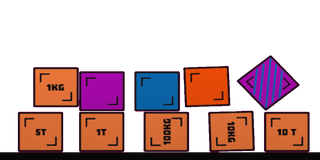
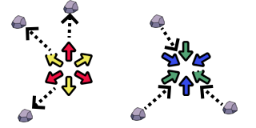

# Physics and Forces

[Wiki Home](../README.md) · [Elements](../README.md#explore-the-wiki)

Solid objects follow rigid-body physics: they fall, collide, slide, bounce, and rotate. Their response depends on mass, shape, surface properties, constraints, and external forces.

## Mass, Gravity and Motion

Mass determines how strongly an object resists changes in motion. Weight is the force caused by gravity. A moving object has inertia and continues moving until collisions, friction, constraints, or other forces change its motion.

[Change Gravity](../elements/powers.md#change-gravity) changes the direction of gravity. Device-orientation gravity is also available on supported devices through [Liquid Settings](liquid-physics.md#liquid-settings).

## Material Properties

*Weighted boxes and surface variants provide simple comparisons of mass, friction, and bounce. See [Physics Objects](../elements/objects-and-decoration.md#physics-objects).*

| Property | Gameplay effect |
| --- | --- |
| Density and mass | Affect how difficult a part is to accelerate and how heavily it loads a construction. |
| Friction | Controls resistance to sliding and helps wheels grip surfaces. |
| Bounciness | Controls how strongly objects rebound after a collision. |
| Shape and size | Affect contact points, balance, rotation, and interaction with liquid. |

[Building Materials](../elements/building-materials.md) provide different construction properties. [Weighted boxes and physics objects](../elements/objects-and-decoration.md#physics-objects) let you compare mass, friction, and bounce. [Terrain](../elements/terrain.md) supplies slippery and bouncy surfaces.

## Rotation and Stability

A force applied away from an object's center can make it rotate. The distribution of mass affects balance: cargo placed high up or far to one side can make a vehicle or boat unstable. Connections restrict which movements are possible.

A [Stabilizer](../elements/functional-elements.md#stabilizer) helps keep a construction upright. For floating objects, see [Liquid Physics](liquid-physics.md).

## Applied Forces

*Pushers apply outward force; Attractors pull nearby elements inward. See [Force and Movement](../elements/functional-elements.md#force-and-movement).*

Thrusters drive their attached construction forward. Fans and Boosters apply directional forces to other objects. Attractors pull nearby elements inward, while Pushers repel them. Black Holes combine attraction with destruction.

See [Functional Elements](../elements/functional-elements.md#force-and-movement) for force sources and [Building and Connections](building-and-connections.md) for powered joints.

## Try This

Drop a normal, slippery, and bouncy box onto the same ramp. Then compare weighted boxes on a simple vehicle to observe acceleration, traction, and stability.

## Related Guides

[Building Tutorials](../guides/building-tutorials.md) · [FAQ and Troubleshooting](../guides/faq-and-troubleshooting.md)

## Other Gameplay Systems

[Liquid Physics](liquid-physics.md) · [Temperature](temperature.md) · [Building and Connections](building-and-connections.md) · [Destruction, Explosions and Weapons](destruction-explosions-and-weapons.md) · [Machines and Automation](machines-and-automation.md) · [Ragdolls and Chemicals](ragdolls-and-chemicals.md)

