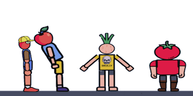

# Ragdolls and Chemicals

[Wiki Home](../README.md) · [Elements](../README.md#explore-the-wiki)

Ragdolls combine connected physical body parts with life, movement, and damage states. A character's condition and its physical construction both determine whether it can move and survive.

## Movement and Custom Bodies

*Ragdolls consist of connected body parts that respond to movement and external forces. See [Body-Part Sets](../elements/ragdolls-body-parts-and-chemicals.md#body-part-sets).*

Living ragdolls can walk when their condition and ground contact allow it. Collisions, broken connections, missing parts, and chemical effects can change this behavior.

Use a [predefined ragdoll](../elements/ragdolls-body-parts-and-chemicals.md#predefined-ragdolls) or, where custom-body tools are available, assemble [body parts](../elements/ragdolls-body-parts-and-chemicals.md#body-part-sets) with a [Human Joint](../elements/joints-and-connectors.md#human-joint). Joint angle limits, rigidity, and resistance control movement and durability. See [Building and Connections](building-and-connections.md).

## Injuries, Life and Death

Strong impacts and weapon hits can damage body parts. Parts can bleed, be crushed, or become detached. Severe injuries can kill a ragdoll; a motionless body is not necessarily an intact or healthy character.

Weapons and shrapnel add impact damage. Fire and cold can harm a ragdoll, and prolonged submersion can cause drowning. See [Destruction, Explosions and Weapons](destruction-explosions-and-weapons.md), [Temperature](temperature.md), and [Liquid Physics](liquid-physics.md).

## Infection and Chemicals

*Chemical tools apply special effects to a ragdoll, changing its condition or behavior. See [Ragdoll Chemicals](../elements/ragdolls-body-parts-and-chemicals.md#ragdoll-chemicals).*

Virus particles multiply and can infect ragdolls on contact. The Virus Chemical applies infection directly. Other chemicals change behavior, durability, or the body's condition.

| Chemical | Effect |
| --- | --- |
| Virus | Infects the ragdoll. |
| Bomb | Causes the ragdoll to explode. |
| Crazy | Makes its behavior erratic. |
| Godlike | Makes the ragdoll immortal. |
| Burn | Sets the ragdoll on fire. |
| Tear | Causes the body to tear apart. |
| Aggressive | Makes the ragdoll aggressive. |
| Paralyze | Paralyzes the ragdoll. |
| Rocket | Launches the ragdoll into the air. |

See [Ragdoll Chemicals](../elements/ragdolls-body-parts-and-chemicals.md#ragdoll-chemicals) for the complete reference.

## Try This

Place a ragdoll on level ground and observe it before adding an obstacle. For separate comparisons, apply one chemical at a time to a fresh ragdoll in the same scene.

## Related Guides

[Getting Started](../guides/getting-started.md) · [FAQ and Troubleshooting](../guides/faq-and-troubleshooting.md)

## Other Gameplay Systems

[Liquid Physics](liquid-physics.md) · [Temperature](temperature.md) · [Building and Connections](building-and-connections.md) · [Destruction, Explosions and Weapons](destruction-explosions-and-weapons.md) · [Physics and Forces](physics-and-forces.md) · [Machines and Automation](machines-and-automation.md)

