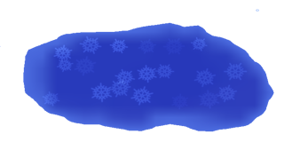

# Temperature

[Wiki Home](../README.md) · [Elements](../README.md#explore-the-wiki)

Temperature connects liquids, solids, gases, fire, and living ragdolls. Heat and cold can change a material's state, ignite it, or damage it. Materials respond differently; heating every substance does not produce the same reaction.

## Heat and Cold Sources

*Cooling affects an area and can extinguish fire or change a material's state. See [Freeze](../elements/powers.md#freeze).*

[Fire](../elements/powers.md#fire), lava, burning objects, and a [Heater](../elements/functional-elements.md#heater) supply heat. [Freeze](../elements/powers.md#freeze) and a [Cooler](../elements/functional-elements.md#cooler) lower temperatures. Nearby sources influence the outcome, so a material can heat up again after cooling.

## Combustion and Fire Spread

*The Fire tool ignites suitable materials and explosives; the resulting reaction depends on the target. See [Fire](../elements/powers.md#fire).*

Wood and coal can burn. Burning materials heat their surroundings and can ignite nearby parts. Continued combustion consumes burnable material and can weaken a construction.

Water and cooling can extinguish fire. A remaining ignition source may start it again. This connects temperature to [Destruction](destruction-explosions-and-weapons.md) and [Liquid Physics](liquid-physics.md).

## Material Reactions and State Changes

| Material | Response |
| --- | --- |
| Water | Freezes into ice or evaporates into water vapor. |
| Ice | Melts back into water. |
| Vapor | Condenses back into water as it cools. |
| Lead | Melts when heated and solidifies again as it cools. |
| Lava | Can ignite other materials and becomes stone when cooled. |
| Oil | Burns after ignition. |
| Petrol | Explodes after ignition. |
| Nitro | Produces a violent explosion after ignition. |
| Magnesium | Burns very brightly. |
| Thermite | Burns extremely hot and can spread fire. |

See [Chemical Materials](../elements/chemical-materials.md) and [Liquid Powers](../elements/powers.md#liquid-powers) for the individual substances.

## Gases and Vapor

Gases move through available space; their movement depends on the gas type and applied forces. Light gases rise, while special gases can supply heat, cold, or explosive effects. Water vapor can return to liquid water through condensation.

The [Gas Elements](../elements/gases.md#gas-elements) reference distinguishes combustible gases, cooling gases, hot plasma, and inert gases.

## Ragdoll Reactions

Burning and freezing can damage ragdolls and affect their ability to move or survive. See [Ragdolls and Chemicals](ragdolls-and-chemicals.md) for injuries and chemical effects.

## Try This

Collect water in a basin, heat it to produce vapor, and use cooling to observe water returning. Separately compare how Oil, Petrol, and Nitro react to the same ignition source.

## Related Guides

[Getting Started](../guides/getting-started.md) · [FAQ and Troubleshooting](../guides/faq-and-troubleshooting.md)

## Other Gameplay Systems

[Liquid Physics](liquid-physics.md) · [Building and Connections](building-and-connections.md) · [Destruction, Explosions and Weapons](destruction-explosions-and-weapons.md) · [Physics and Forces](physics-and-forces.md) · [Machines and Automation](machines-and-automation.md) · [Ragdolls and Chemicals](ragdolls-and-chemicals.md)

